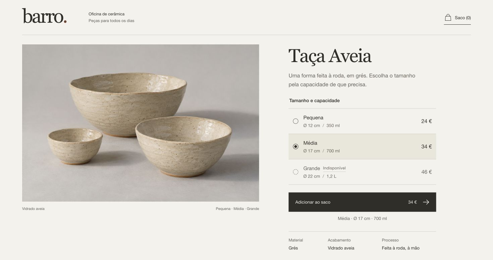
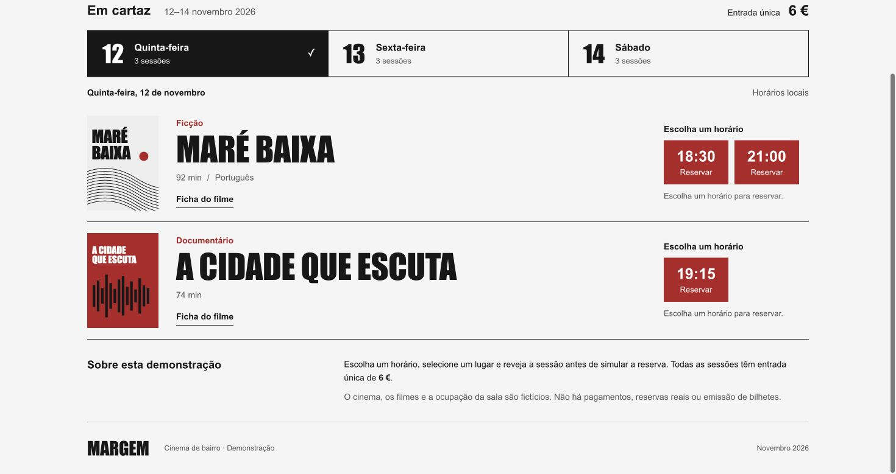
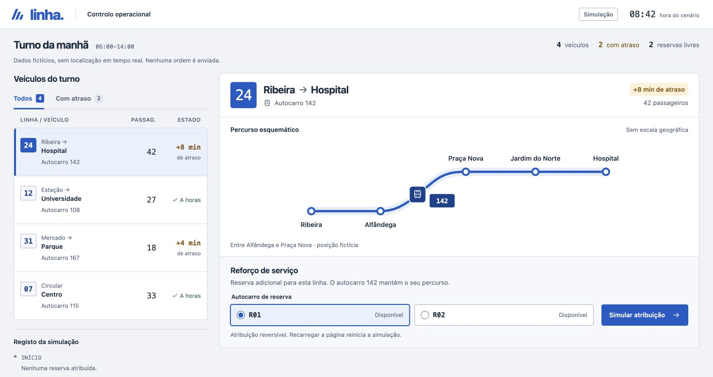

# Authentic Design

**Interfaces with a reason to look and work the way they do.**

An open Agent Skill for designing web and app experiences from the product's users, content, and tasks. It helps an agent develop a specific identity, build usable flows, and question habitual layouts instead of changing colors on the same template.

[Português](README.pt-BR.md) · [Skill](SKILL.md) · [Evaluation method](evals/README.md) · [Sources](references/sources.md)

## What it changes

- Starts with the user's task and the information needed to complete it.
- Separates task structure from visual identity: different flows can still share the same visual shell.
- Compares visible direction studies with the same real content, then carries one coherent identity into implementation.
- Uses substitution, silhouette, visual-identity, removal, continuity, and evidence checks to challenge interchangeable design.
- Keeps familiar controls and existing product systems consistent.
- Covers content, failure states, responsive behavior, accessibility, and honest validation.
- Compares previous work when it is supplied or authorized; it does not secretly track other projects.

There is no universal palette, required font, mandatory card layout, or random style picker. A restrained utility and an expressive cultural product should not inherit the same composition merely because the agent made both.

## Independent v0.3 round

[Three new projects, source and screenshots](evals/results/independent-v03.md): Malha, Quintal and Zênite. Each creator received functional requirements and the frozen skill only. Tested flows worked and visible direction studies were produced, but identity diversity remains **partial**: Malha and Quintal repeated a cream/green/Georgia family, and brand details recurred in all three. Original outputs are preserved without evaluator corrections.

## Rendered examples

| Barro · pottery | Margem · cinema | Linha · transit |
| --- | --- | --- |
|  |  |  |

[Run the prototypes locally](examples/interface-lab/README.md) · [Read the observed failures and revisions](evals/results/rendered-interfaces.md)

## Install

This repository is the skill folder: `SKILL.md` is at its root. Copy the folder into the skills directory supported by your agent, preserving `references/` and `agents/`. Consult your host's instructions for discovery and activation.

For a Codex installation that uses `~/.codex/skills`:

```sh
git clone https://github.com/Enzoramo/authentic-design.git ~/.codex/skills/authentic-design
```

If that directory already exists, inspect it before updating; do not overwrite local changes. Start a new session or use the host's skill reload mechanism. This is an instruction-only skill: no API key, build step, runtime package, or paid service is required. Rendering and implementation depend on tools available in the host.

## Use

```text
Use $authentic-design to build a booking flow for a bicycle repair shop.
Customers often do not know the names of bicycle parts. Show an estimated
price, let them choose a drop-off slot, and provide review before requesting
the booking. Use Portuguese and the existing project stack.
```

```text
Use $authentic-design to improve this dashboard's information hierarchy.
Keep our current brand, navigation, and components. Focus on identifying
overdue work and recovering from an empty search.
```

```text
Use $authentic-design to create a second concept for this product.
Here is the first concept. Change the organizing idea, explain the tradeoff,
and preserve the functional requirements.
```

Give the agent real content, audience, main task, constraints, and any existing design when available. It can work with incomplete briefs, but it should identify assumptions rather than invent research. Explicit invocation syntax and automatic discovery vary by host.

## How the skill is organized

| File | Purpose |
| --- | --- |
| [SKILL.md](SKILL.md) | Task routing, design process, and acceptance behavior |
| [UX and content](references/ux-and-content.md) | Decisions, flows, states, copy, evidence |
| [Art direction](references/art-direction.md) | Contextual identity and structural alternatives |
| [Design continuity](references/design-continuity.md) | Consistency and authorized comparison |
| [Review and validation](references/review-and-validation.md) | Observable checks and reporting limits |
| [Evaluation cases](evals/cases.json) | Reusable behavior scenarios and review criteria |

Supporting references are read when relevant. The skill does not require loading the entire repository or following an elaborate process for a small fix.

## Validation and limits

Version 0.3.0 adds comparable visual specimens, explicit identity selection and a study-to-implementation check. Existing brands and small fixes skip fresh-identity exploration. These changes address a repeated visual family observed in independent v0.2 outputs; they impose no palette, font pair or style preset.

Version 0.2.0 incorporated findings from [three rendered interface trials](evals/results/rendered-interfaces.md): product comparison, cinema booking, and transport operations. The report includes before/after screenshots, executable sources, interaction checks, and limitations. See the [evaluation record](evals/README.md) for all runs. Structural validation is not design validation. Written concepts do not establish the quality of a rendered interface, and self-review does not replace participant research.

No skill can guarantee that every result will be unique or objectively the best. Output depends on the model, brief, assets, implementation tools, and feedback. “Authentic” here means specific and coherently reasoned; it does not mean undetectable AI authorship, imitation of a designer, or verified originality across the internet.

A separate [independent v0.2 follow-up](evals/results/independent-v02.md) tested three new briefs without extra style direction or reviewer corrections. Main flows worked, but cool pale surfaces, dark blue ink and strong sans-serif headings recurred. The result supports task differentiation more strongly than independent visual identity. The archived v0.2 snapshot remains unchanged.

## Contribute

Submit a reproducible brief, the skill version, relevant host/model information, the observed output, and the specific decision that failed. Use synthetic or shareable material; remove private client data. Include a case where the proposed change should **not** apply, so an improvement does not become another universal style rule.

Prefer small changes backed by observed behavior. The [evaluation guide](evals/README.md) explains how to compare versions. Do not advertise conversion improvements, accessibility compliance, or benchmark wins without corresponding evidence.

## License

[MIT](LICENSE). Third-party references, fonts, images, and other external assets retain their own licenses.
