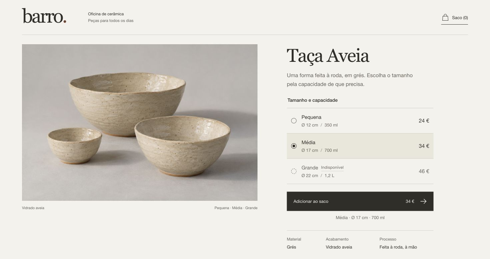
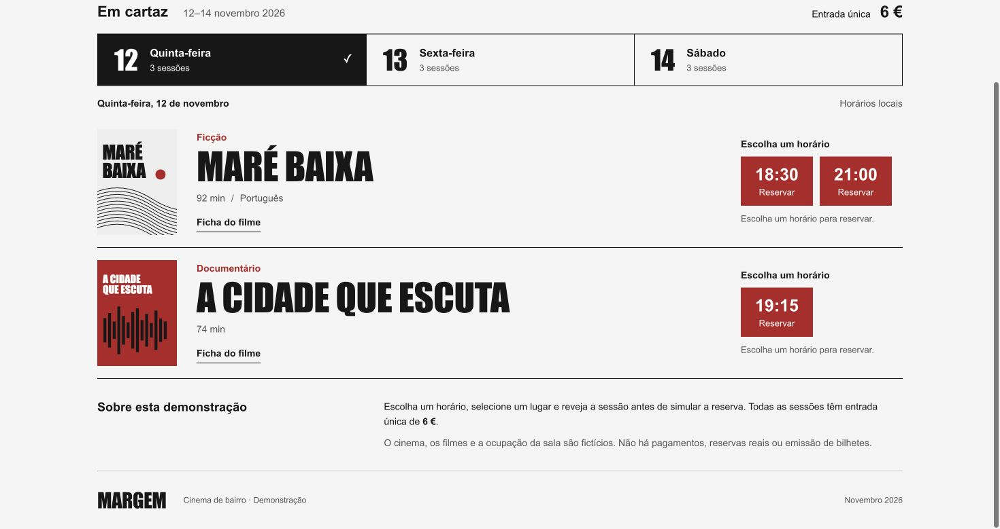
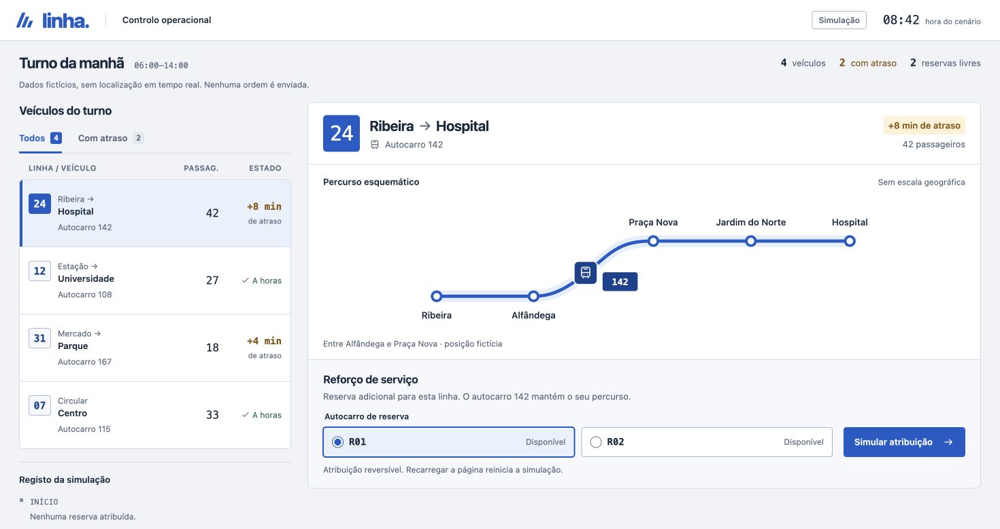

# Authentic Design

**Interfaces com motivo para ter aquela aparência e funcionar daquele jeito.**

Uma skill aberta para criar experiências web e apps a partir do público, do conteúdo e das tarefas de cada produto. O objetivo é desenvolver identidade própria e UX utilizável, evitando repetir a mesma estrutura com outras cores.

[English](README.md) · [Skill](SKILL.md) · [Avaliação](evals/README.md)

## O que ela faz

- Entende a tarefa principal antes de escolher o estilo.
- Separa estrutura da tarefa e identidade visual: fluxos distintos ainda podem compartilhar a mesma aparência.
- Compara estudos visuais com o mesmo conteúdo e leva a identidade escolhida até a implementação.
- Questiona estruturas intercambiáveis, decoração sem função e afirmações sem evidência.
- Preserva padrões úteis de interação e a consistência de um produto existente.
- Considera textos, erros, recuperação, responsividade e acessibilidade.
- Compara trabalhos anteriores somente quando estão disponíveis e o acesso está autorizado.

Não há paleta fixa, fonte obrigatória ou sorteio de estilos. A diferença precisa fazer sentido para o produto. Criar outra tela do mesmo app, por exemplo, normalmente exige continuidade visual.

## Rodada independente da v0.3

[Três projetos inéditos, fontes e capturas](evals/results/independent-v03.md): Malha, Quintal e Zênite. Cada agente recebeu apenas requisitos funcionais e a skill congelada. Os fluxos verificados funcionaram e os estudos visuais foram produzidos, mas a diversidade de identidade ainda foi **parcial**: Malha e Quintal repetiram uma família creme/verde/Georgia, e detalhes de marca se repetiram nos três. As saídas originais foram preservadas, sem correção do avaliador.

## Exemplos renderizados

| Barro · cerâmica | Margem · cinema | Linha · transporte |
| --- | --- | --- |
|  |  |  |

## Instalação

Este repositório já é a pasta da skill. Copie a pasta para o diretório de skills aceito pelo seu agente, mantendo `SKILL.md`, `references/` e `agents/`.

Em instalações do Codex que usam `~/.codex/skills`:

```sh
git clone https://github.com/Enzoramo/authentic-design.git ~/.codex/skills/authentic-design
```

Se a pasta existir, confira as alterações locais antes de atualizar. Abra uma nova sessão ou use o recarregamento de skills disponível no seu ambiente. Não exige chave de API, pacote de execução ou serviço pago. As ferramentas do ambiente determinam o que pode ser implementado e verificado.

## Como usar

```text
Use $authentic-design para criar um fluxo de agendamento para uma oficina
de bicicletas. O cliente pode não conhecer os nomes das peças. Mostre uma
estimativa, permita escolher um horário e revisar antes de solicitar.
Use português e mantenha a tecnologia do projeto.
```

```text
Use $authentic-design para melhorar este app sem mudar a marca.
Priorize a tarefa principal, estados de erro e uso no celular.
```

```text
Use $authentic-design para criar um segundo conceito com uma organização
diferente desta referência. Preserve os requisitos e explique as escolhas.
```

Forneça conteúdo real, público, tarefa principal, restrições e referências quando tiver. A skill orienta o agente a declarar hipóteses e fazer perguntas relevantes, sem inventar entrevistas ou resultados de pesquisa. A sintaxe e a descoberta automática dependem do agente.

## Qualidade e limites

A versão 0.3.0 acrescenta estudos visuais comparáveis, escolha explícita da identidade e comparação entre estudo e implementação. Marcas existentes e pequenos ajustes preservam seu sistema. A mudança responde à repetição visual observada na v0.2, sem impor paletas, pares de fontes ou estilos prontos.

A versão 0.2.0 incorporou uma rodada com três interfaces renderizadas: cerâmica, cinema e transporte. O [relatório](evals/results/rendered-interfaces.md) mostra antes/depois, verificações e limites. Os [protótipos completos](examples/interface-lab/README.md) podem ser executados localmente. O [registro de avaliação](evals/README.md) distingue testes executados de cenários apenas propostos. Nenhuma skill garante que toda criação será inédita ou que será a melhor em qualquer situação.

Aqui, autenticidade significa escolhas específicas e coerentes. Não significa esconder o uso de IA, copiar a identidade de outro designer ou comprovar originalidade em toda a internet. O resultado depende também do modelo, do briefing, dos materiais e das revisões.

As instruções da skill estão em inglês para facilitar a distribuição; a interface criada deve usar o idioma e a localidade pedidos pelo usuário.

Uma [rodada independente da v0.2](evals/results/independent-v02.md) testou três projetos novos sem dicas adicionais de estilo nem correções do avaliador. Os fluxos principais funcionaram, mas fundos claros frios, azul escuro e títulos sem serifa fortes se repetiram. O resultado foi parcial: tarefas distintas, identidade visual ainda recorrente. O snapshot arquivado da v0.2 permanece sem alterações.

## Contribuição e licença

Contribua com um briefing reproduzível, versão usada, resultado observado e problema concreto. Remova dados privados e inclua um caso em que a nova regra não deve valer. Consulte o [método de avaliação](evals/README.md).

[Licença MIT](LICENSE). Materiais externos continuam sujeitos às respectivas licenças.
