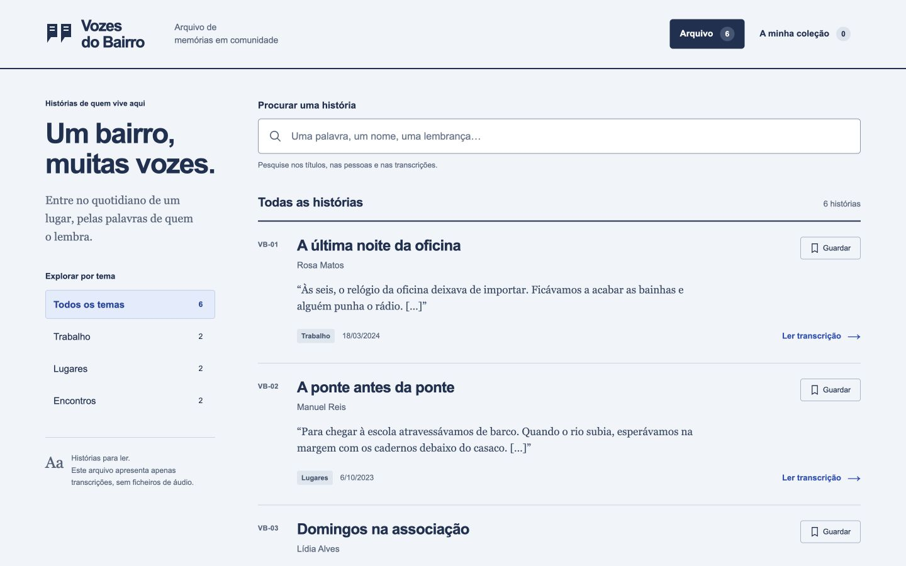
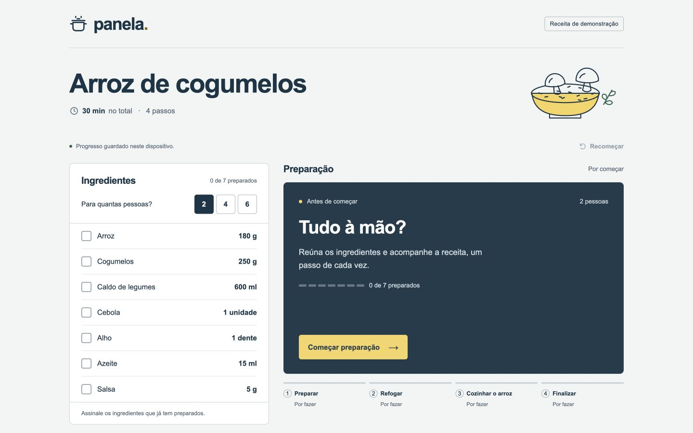
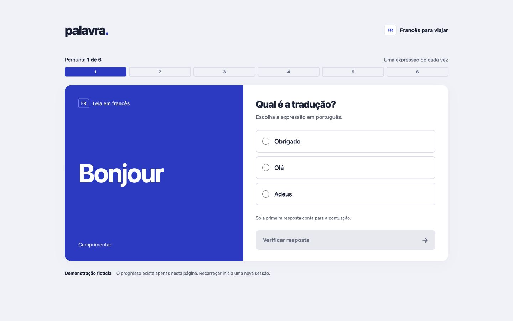

# Independent v0.2 trials — 2026-11-13

**Result: strong task differentiation in the exercised flows, partial visual differentiation.** The three submitted implementations worked in the main browser scenarios, but all converged on cool pale backgrounds, strong sans-serif headings and dark blue ink. The archive's serif transcripts, the kitchen's ingredient/step relationship and yellow actions, and the learning interface's bilingual panel establish some character. They do not establish three fully independent visual identities.

This is evaluator judgment grounded in the screenshots and implementation, not a blinded originality score or participant finding. No cosmetic corrections were made after submission. The skill is still v0.2.0.

## Method and provenance

The user requested three new projects with no extra style hints. Three fresh agent contexts each received one functional brief, a frozen copy of v0.2.0 and its references, and an isolated output folder. They did not receive earlier outputs, the other projects, the evaluator's comparison criteria or style corrections. They could inspect and revise their own source before submitting. The evaluator rendered the submitted files unchanged and supplied no feedback to the authors.

- Skill commit: `41e2970b712473234e50dd5b1f53946422cf3485`.
- `SKILL.md` SHA-256: `1906f0afa69b8d7dd2ef71cadf9d6fb2d72c93451dadbcef499cc2a0bc58d53f`.
- [Exact briefs, frozen input hashes and review protocol](../../examples/v02-independent/inputs/).
- [Unchanged submitted sources and local run instructions](../../examples/v02-independent/README.md).
- [Browser verification record](../../examples/v02-independent/QA.md).

The skill itself contains design guidance, including examples from the earlier round. "No style hints" means no additional visual direction in the briefs, not removal of the skill's own guidance. Brand names, content, functional requirements, Portuguese locale and static HTML/CSS/JavaScript delivery were supplied. No palettes, typefaces, compositions, reference images or chosen visual directions were supplied. All assets had to be local; authors could create original ones. No brand/photographic assets were supplied.

Host: Codex desktop, macOS, Chrome. Exact model build and sampling settings were not captured. Browser control was reserved for the parent evaluator to avoid concurrent interaction with one browser session. The authors therefore submitted source-checked implementations without their own browser QA. There was one independent implementation per brief; this is not a matched comparison with v0.1 or a no-skill control.

## Submitted results

### Vozes do Bairro — an oral-history archive

Task: find one of six fictional stories, read a complete transcript, and maintain a local reading collection.

The output uses an index with topic navigation, search, excerpts and a reading dialog. Typography distinguishes interface labels from the quoted accounts. Save/remove state and empty-search recovery support the actual archive task; no fake audio playback is presented.

### Panela — a cooking companion

Task: scale a supplied recipe to 2/4/6 people, prepare ingredients, follow four steps and resume later.

The output relates ingredients to a single current step. On a phone it switches between ingredients and preparation rather than stacking both long panels. Serving changes retain checks but explicitly ask the cook to reconfirm prepared quantities. A small original inline illustration supplies subject-specific detail.

### Palavra — French vocabulary practice

Task: answer six questions, see first-attempt results, review missed items and restart.

The output pairs the French expression with Portuguese choices. Feedback and the final review preserve the first answer and initial score. It reuses the same two-part composition for the question and result, with a clear perfect-session state.

## What differs, and what still repeats

| Dimension | Observed distinction | Observed repetition or limit |
| --- | --- | --- |
| Information model | Searchable reading index; persistent preparation sequence; question/check/review loop. | These differences are partly required by the briefs; they cannot be attributed solely to the skill. |
| Composition | Archive has a topic margin and continuous excerpts; kitchen keeps ingredients next to an active instruction; practice pairs source expression and choices. | Kitchen and learning both use a large filled panel next to a pale/white task panel. Similar card geometry persists despite different content. |
| Type | Archive uses Georgia for transcripts; other tasks stay with sans-serif. | Archive and kitchen use Arial/Helvetica; learning uses system sans. Large heavy sans headings and tight wordmarks remain a common default. |
| Palette | Kitchen adds yellow actions and green ingredient completion; archive has a subdued blue reading environment; practice uses stronger blue and explicit answer states. | All use cool pale surfaces and dark blue ink. Archive: `#f0f4f8` / `#1d3151`; kitchen: `#f2f5f5` / `#183547`; practice: `#f0f2f8` / `#192037`. Blue remains prominent across the set. |
| Identity details | Quote mark, transcript type, cooking illustration, recipe quantities, bilingual expression and truthful score. | Kitchen and practice independently use bold lowercase wordmarks with a colored full stop. Right-arrow action treatments also recur. These conventions are not inherently defects; the combined similarity limits the stronger claim of distinctive brand identity. |
| Responsive behavior | Archive reading becomes a full-screen dialog; kitchen gains two task views; practice stacks its bilingual halves. | Only Chrome at the tested sizes was inspected. No native app or cross-platform typography test was run. |

The evidence supports **context-specific interfaces**, not indiscriminate novelty. The remaining gap is independent art direction: the skill can change what a page does and how it organizes the task while still falling back to a familiar visual family.

## Verified behavior and observed defect

At 1440 × 900 desktop, 390 × 844 phone and 320 × 740 narrow phone widths:

- **Archive:** transcript-text search, topic filtering, combined no-match state and reset; full-record reading; save, reload, collection persistence, removal and empty collection; Escape and focus return. At 320 px the reading dialog fits the viewport and can scroll to its controls.
- **Kitchen:** exact displayed scaling for 2/4/6 people; prepared check state and serving-change reminder; all seven checked; step progression, back/review and reload retaining six servings, seven ingredients and step 2; explicit finish; cancel/confirm restart; mobile ingredient/preparation switching and narrow current-step controls. Restart intentionally retains the selected servings and clears progress.
- **Practice:** initial disabled verification without selection; one wrong plus five correct answers yields 5/6; review of the single missed expression leaves the initial 5/6 unchanged; a new shuffled session with all six correct yields 6/6 and no empty review action. Feedback receives focus, and the flow remains operable at 320 px.

No horizontal document overflow was observed at the measured phone widths, and the browser log tool returned no error/warning records during final checks. The authors' own source/model checks are recorded in their unchanged DESIGN.md files; those reports are separate from the evaluator's browser evidence. The copied submissions were verified byte-for-byte against the hashes saved at delivery; local asset references resolve.

One visible finish defect remains in the archive at 390 px: the heading appears as **“Um bairro,muitas vozes.”**. A desktop line break is hidden at the mobile breakpoint without supplying a separating space. It was deliberately left unchanged to preserve the independent result. No blocker was observed in the exercised primary flows; that is not a claim that all possible states are defect-free.

## Interpretation and limits

The practical answer is partial: v0.2 produced three functioning, task-specific interfaces without parent style coaching, but it did not fully escape a recurring visual signature. The comparison does not justify calling all three wholly original, proving originality across the internet, or declaring v0.2 better than v0.1. Different tasks, one sample each, no control, and evaluator judgment cannot establish causality or a reliable success rate.

There was no participant research, full accessibility audit, screen-reader session, native-app test or multi-browser review. Local system fonts and lack of supplied brand assets constrain the visual comparison. The skill and prototype files were not revised in this round. A future improvement should be separately tested on held-out briefs; swapping colors after this comparison would not prove independent improvement.

The new hosted gallery could not be published: the Sites connector rejected source access with `sites_git_client_upgrade_required`. The previously published gallery remains unchanged. This does not affect the local browser tests or the executable evidence preserved in the repository.
