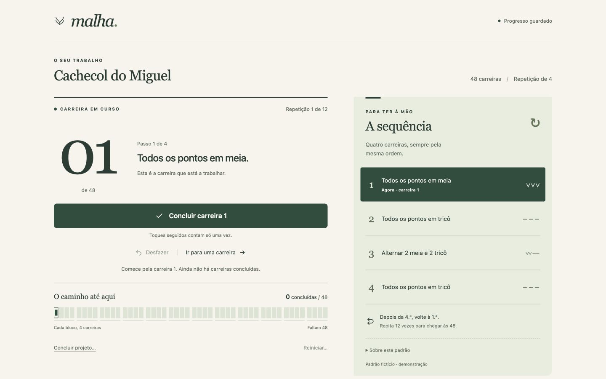
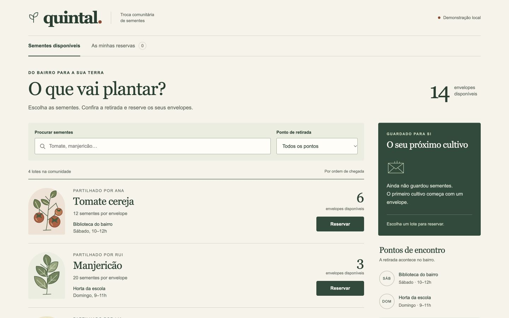
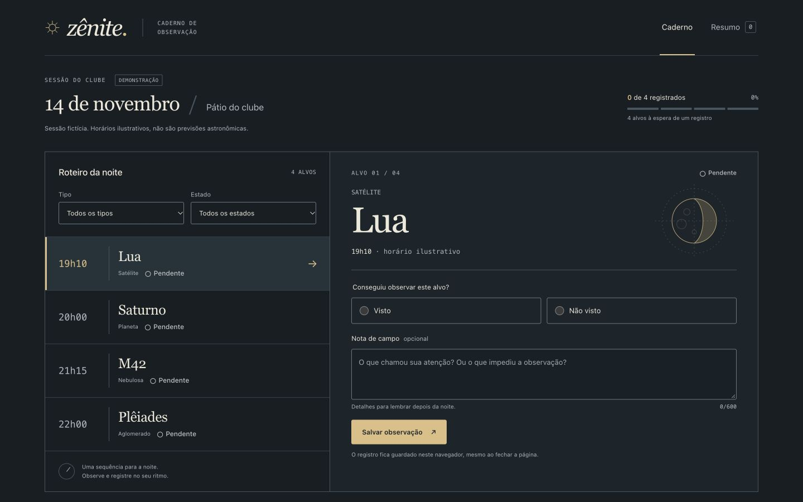

# Independent v0.3 trial: visible exploration, recurring identity

**Result: partial.** Three new products produced working task-specific interfaces and actual visual direction studies. Independent visual diversity remains insufficient: Malha and Quintal selected a closely related cream/green/Georgia family, and all three retained several shared brand conventions. This release should not be advertised as solving repetition or guaranteeing originality.

## What changed before the tests

Version 0.3.0 separates task structure from visual identity, asks for comparable visual specimens using the same functional content, records a selected identity and checks whether implementation preserves it. It keeps existing-brand and small-fix exceptions. No prescribed palette, font pairing, genre or style roulette was added. This addresses v0.2's navigation-only alternatives without banning individual colors or typefaces.

## Method and inputs

Instructions finalized and frozen on 2026-11-13 before launching the three new briefs. SKILL.md SHA-256: `e8a28dc52ea10c9955421c898828bc6ce10f8cfce804bc596d59c8a777d604a4`. The frozen entrypoint and five references are preserved in [inputs](../../examples/v03-independent/inputs/). The snapshot entrypoint is named `entrypoint.md` to avoid nested automatic skill discovery; its bytes match the original hash.

Three subagents started with empty conversation context, the same frozen skill, one Portuguese functional request and a separate temporary output folder. They received no palette, typography, composition reference, expected answer or earlier output. They were instructed not to consult other projects/agents/design skills or publish. Static HTML/CSS/JavaScript and local assets were required. Browser operation was reserved for the evaluator, so creators' choices were not browser-verified before submission. Exact host model identifiers and sampling parameters were not captured.

[Protocol](../../examples/v03-independent/inputs/protocol.json), [prespecified review](../../examples/v03-independent/inputs/REVIEW-PROTOCOL.md), requests: [Malha](../../examples/v03-independent/inputs/knitting/REQUEST.md), [Quintal](../../examples/v03-independent/inputs/seeds/REQUEST.md), [Zênite](../../examples/v03-independent/inputs/astronomy/REQUEST.md).

The evaluator collected and hashed each closed submission, then rendered and tested it without source corrections. [Original files and run instructions](../../examples/v03-independent/README.md), [hashes](../../examples/v03-independent/SHA256SUMS.json), [browser QA](../../examples/v03-independent/QA.md).

## Outputs

### Malha — knitting progress

A large row count sits beside the current instruction; a ruler groups 48 rows into twelve cycles of four. The same grammar survives completion and phone layouts. Advance protection, undo, jump validation, final confirmation, restart recovery and reload were exercised.

[Three direction specimens](../../examples/v03-independent/screenshots/knitting-study.jpg) · [Phone working state](../../examples/v03-independent/screenshots/knitting-mobile.jpg) · [Creator decisions](../../examples/v03-independent/dist/knitting/DESIGN.md)

### Quintal — community seed exchange

Illustrated horizontal inventory rows combine species, envelope quantity and pickup details, with a reservation summary alongside. Quantity limits, review, confirmation, persistence, cancellation stock recovery, filtering and empty-state recovery worked in the tested paths.

[Three direction specimens](../../examples/v03-independent/screenshots/seeds-study.jpg) · [Phone cancellation](../../examples/v03-independent/screenshots/seeds-mobile-cancel.jpg) · [Creator decisions](../../examples/v03-independent/dist/seeds/DESIGN.md)

### Zênite — observation journal

A chronological margin sits beside a dark observation page; serif object names and monospaced times continue into the summary. Seen/not-seen/pending remain distinct. Notes, editing, reload, combined filters, empty recovery and phone selection were exercised.

[Two direction specimens](../../examples/v03-independent/screenshots/astronomy-study.jpg) · [Phone editor](../../examples/v03-independent/screenshots/astronomy-mobile-editor.jpg) · [Creator decisions](../../examples/v03-independent/dist/astronomy/DESIGN.md)

## What the comparison supports

| Dimension | Observed evidence | Finding |
| --- | --- | --- |
| Task structure | Ruler/counter, illustrated inventory, chronological journal | Different and tied to the briefs |
| Exploration | 3 / 3 / 2 rendered specimens with comparable task content | Visual alternatives are now observable; selection was source-based |
| Carry-through | Selected type, layout relationships and states survive implementation | Substantive adherence in these outputs |
| Visual families | Cream/green/Georgia repeats in Malha and Quintal; dark journal differs | Diversity objective only partially met |
| Small signatures | All three use lowercase serif wordmark + dot + line icon; small uppercase labels and rules recur | Shared model habits remain |
| Functional checks | Main and recovery paths passed at measured desktop/phone states | Evidence for tested paths, not participant usability or full accessibility |

Approximate identity tokens are inspectable in the original CSS: Malha paper `#f7f4ec`, ink `#283e35`, action `#294d3c`; Quintal paper `#f6f3e9`, ink `#243e30`, action `#294b3a`. This is a combined visual family, not a complaint about green or Georgia in isolation. Malha's counter and Quintal's inventory still communicate different tasks; that alone does not establish separate visual identities.

The shared craft/nature subject matter may contribute to convergence; that is an explanation to test, not an excuse or measured cause. All candidates were produced, so the remaining weakness appears in selection and in small recurring defaults, rather than a failure to create alternatives. Two selected their first candidate; Malha selected its third, so this is not simply first-option bias.

## Limits and next experiment

This is not a controlled v0.2-to-v0.3 improvement claim: the briefs differ and there is one sample per task. No no-skill baseline, repeated sampling, independent blinded review, participant research, native-platform test or exhaustive accessibility audit was conducted. Three outputs cannot establish universal originality.

A useful next experiment would hold briefs constant, render candidates before selection, and compare source-derived selection with a selection process that independently challenges repeated typographic/compositional assumptions. When the user supplies or authorizes relevant prior identities, use that history for explicit comparison; do not secretly inspect unrelated projects. Keep existing-brand cases as a counterexample so diversity work does not damage continuity. Do not “fix” this report by recoloring the original outputs.

The installed v0.3 and frozen tested instructions match. Source artifacts, studies and screenshots are published in this repository. The older Sites gallery was not updated: the client already returned `sites_git_client_upgrade_required` in the previous round. These prototypes run locally using the documented static server.
