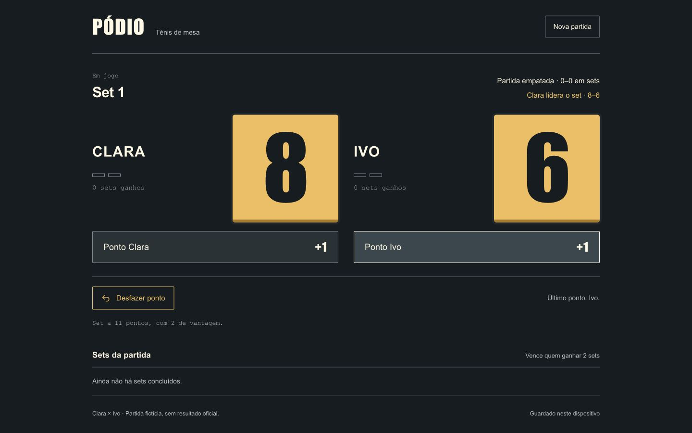
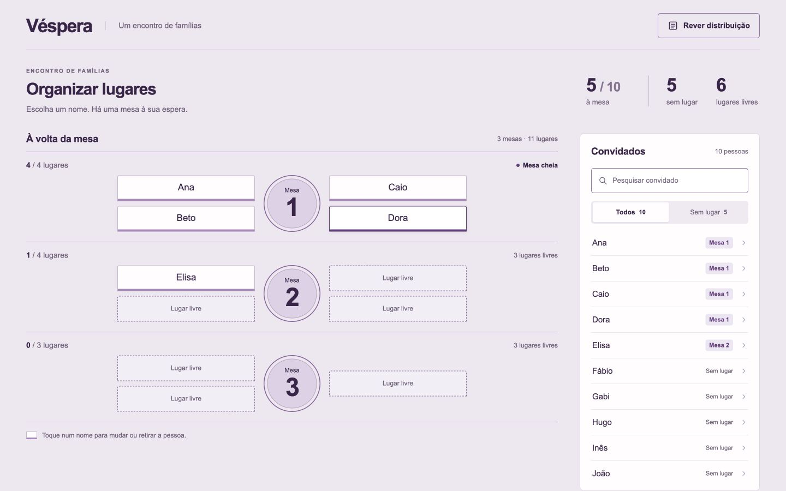
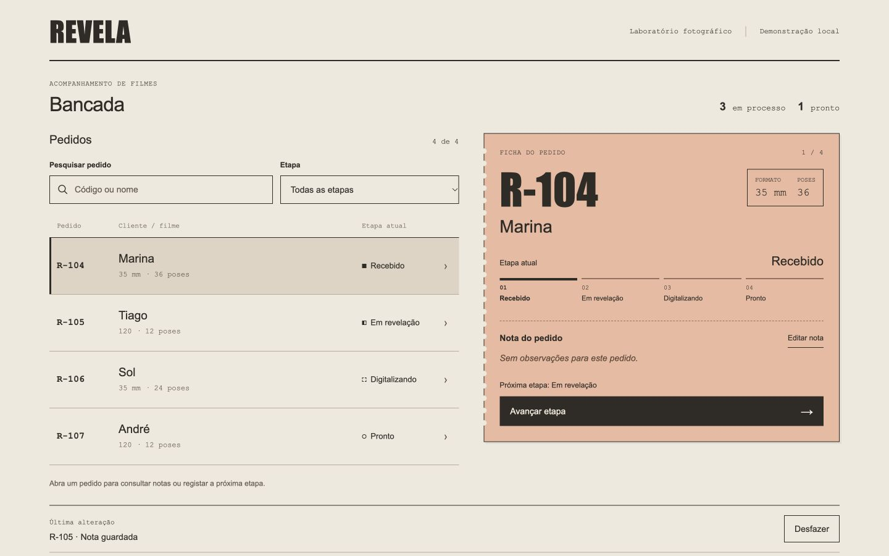

# Independent v0.4: broader identities, residual type reuse

**Observed result:** the three products have clearly different palette relationships and task compositions. The previous cream/green/Georgia bundle and lowercase-serif-dot-icon mark formula did not recur. Typography and mark diversity remain **partial**: Pódio and Revela independently selected Impact and uppercase wordmarks. No claim of universal originality or a controlled improvement is made.

## Change and method

v0.4 makes selection depend on rendered candidates when possible, reviews typography, the full color-role bundle and brand construction separately, asks for a countercase to the preferred option, and rejects unfairly weakened alternatives or unsupported category associations. It preserves existing identities and small-fix scope.

Frozen SKILL.md SHA-256: `dc2c2eaec280602b339be9644ff34ac7170ae4c767c226f091616abb091b9c69`. [Protocol and inputs](../../examples/v04-independent/inputs/) include three functional briefs, frozen instructions and preselection studies. Snapshot `entrypoint.md` preserves the original SKILL.md bytes without creating another discoverable skill.

Three fresh subagents received no external style hints, previous examples or evaluator conclusions. Each created three candidates. A neutral renderer supplied desktop/phone captures; creators inspected their own images and selected B/C/A respectively. They later requested functional captures and made their own corrections before closing. The evaluator neither selected directions nor edited product sources. [QA](../../examples/v04-independent/QA.md) distinguishes that iteration from an unreviewed first attempt. Closed sources are [hashed](../../examples/v04-independent/SHA256SUMS.json).

## Pódio — scorekeeping

A dark two-player field with amber number modules, condensed numerals and monospaced game annotations. Checked tie, sets, terminal victory, undo across a completed set, cancel/confirm reset and reload.

[Studies](../../examples/v04-independent/screenshots/score-study-desktop.jpg) · [Phone](../../examples/v04-independent/screenshots/score-mobile.jpg) · [Creator decisions](../../examples/v04-independent/dist/score/DESIGN.md)

## Véspera — guest seating

White name cards surround table numbers on a lilac floor; purple UI and mixed-case sans typography keep map and list related. Checked assignments, full-table refusal without losing origin, valid move/removal, review, empty-search recovery and persistence.

[Studies](../../examples/v04-independent/screenshots/seating-study-desktop.jpg) · [Phone](../../examples/v04-independent/screenshots/seating-mobile.jpg) · [Creator decisions](../../examples/v04-independent/dist/seating/DESIGN.md)

## Revela — film processing

A neutral inventory sits beside a peach slip with large film code, monospaced metadata and a perforated edge. Checked advance review/cancel/confirm, undo, note persistence, search/filter recovery and the terminal stage.

[Studies](../../examples/v04-independent/screenshots/film-study-desktop.jpg) · [Phone](../../examples/v04-independent/screenshots/film-mobile-320.jpg) · [Creator decisions](../../examples/v04-independent/dist/film/DESIGN.md)

## Assessment by requested dimension

| Dimension | Evidence | Assessment |
| --- | --- | --- |
| Palette | Dark/amber, lilac/purple/white, neutral/peach/brown | Distinct full surface relationships in this sample |
| Typography | Large condensed score digits; sans map/name cards; condensed film codes with monospaced metadata | Roles differ, but Impact repeats in two and Arial supports all three |
| Marks | PÓDIO, Véspera, REVELA; no decorative icon or punctuation suffix | Earlier formula absent; two condensed uppercase constructions still related |
| Composition | Paired score modules, spatial seat map, inventory plus process slip | Meaningfully tied to different tasks |
| Working behavior | Main paths, recovery and reload exercised; phone reflow observed | No blocker in tested paths; not a complete usability/accessibility audit |

Pódio and Revela do not become the same visual system merely because they share Impact: scale, content relationships, palette coverage and graphic treatment differ. Equally, those differences do not justify claiming that repeated font/mark preferences disappeared. This is progress in observable variation with a remaining selection weakness.

## Limits

New briefs, one run each, changed renderer support and no matched v0.3/no-skill control prevent causal attribution. Exact model identifiers/sampling settings were not captured. No participants, independent blinded panel, native-platform or exhaustive accessibility test. A next controlled experiment should hold briefs and rendering support constant and test whether the selected type/mark construction is merely the most convenient available display face. Avoid replacing this residual habit with a universal font blacklist.

[Run the prototypes locally](../../examples/v04-independent/README.md). The previous hosted Sites gallery was not updated. All final evaluator screenshots and creator-requested preflight captures are included, with their different roles documented.
