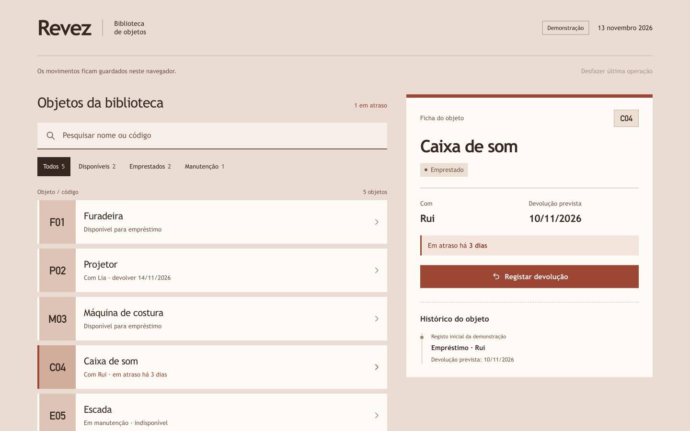
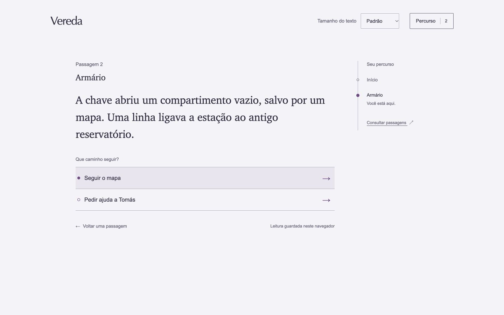
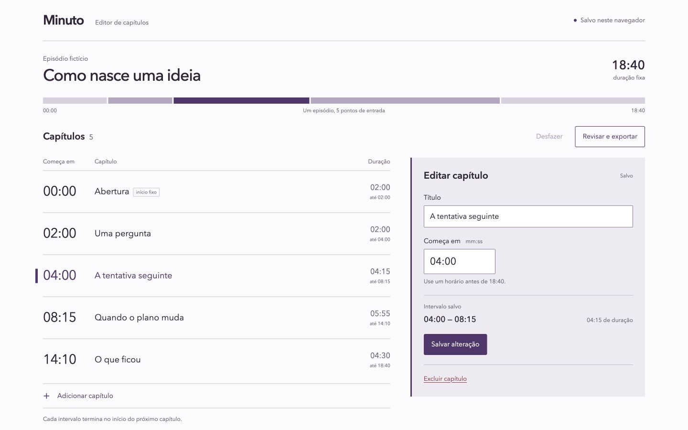

# Independent v0.5: broader typography, remaining similarities

**Observed result:** none of the three new products selected Impact or an all-uppercase product name. The type systems and working compositions differ visibly. This does **not** establish that recurring identity preferences disappeared: all retain initial-capital text names, and Vereda/Minuto share a pale lilac/plum palette family. The result supports the targeted change in this sample, not universal uniqueness or causal improvement over v0.4.

## Change and method

v0.5 separates the name's recognition role from prominent scores, codes or headlines, checks available font resources, and challenges habitual typography through a focused comparison inside a stable composition. It asks for the supplied spelling/case as a reference and a visible reason for changes. It does not name or ban Impact, forbid capitals, impose a replacement serif/sans pairing, or rotate styles. Existing brands and small changes still preserve their systems.

Frozen `SKILL.md` SHA-256: `d65cb1c687ffb336b49da3a8ecba960b72521ff8bcb58435cc622e7b96b3ba44`. [Inputs and protocol](../../examples/v05-independent/inputs/) preserve functional briefs, frozen instructions, original studies and exchanges. Snapshot `entrypoint.md` has the original SKILL.md bytes without duplicate skill discovery.

Three fresh creator contexts received only one functional brief and the frozen skill, without previous examples, evaluator conclusions or style hints. Each made three candidates and a focused type/name comparison, inspected neutral captures, then chose independently. The parent operated a neutral renderer and requested interactions, with no product-source edits or aesthetic instructions. [QA](../../examples/v05-independent/QA.md) documents autonomous revisions before closure and the [hash manifest](../../examples/v05-independent/SHA256SUMS.json) preserves the closed artifacts. These are autonomous iterations, not untouched first screenshots.

## Revez — library of objects

Pale terracotta surrounds separate object labels; codes have stable blocks, names sit with availability, and the selected object becomes a larger working slip. The declared system uses Trebuchet MS for text/name and DIN Alternate for codes. The mixed-case name does not inherit the identifier's capitals.

[Study](../../examples/v05-independent/screenshots/loans-study-desktop.jpg) · [Phone](../../examples/v05-independent/screenshots/loans-mobile-320.jpg) · [Creator decisions](../../examples/v05-independent/dist/loans/DESIGN.md)

Checked required fields/date, loan review/cancel/confirm, unavailable-object restrictions, return, undo, history, reload, search/filter recovery and relevant focus return. Final image shows the overdue C04 loan, not a fabricated empty dashboard.

## Vereda — branching fiction

Large serif passages and open choices align with a narrow visited-path column. The name remains restrained and separate from the reading text; declared Optima/Charter/Arial roles. A near-white lilac field and plum markers support the line/path relationship.

[Study, revised before selection](../../examples/v05-independent/screenshots/story-study-revision-1-desktop.jpg) · [Phone](../../examples/v05-independent/screenshots/story-mobile-320.jpg) · [Creator decisions](../../examples/v05-independent/dist/story/DESIGN.md)

Reached all three endings, changed a route after returning, consulted visited passages, cancelled/confirmed restart, and retained size/progress/scroll position across reload. Enter/Escape and focus return were checked on the route and restart dialogs. Final image shows the second passage, Armário.

## Minuto — audio chapter editor

Large tabular start times, titles and right-aligned durations organize the sequence. A proportional strip shows intervals; the editing area has a lilac surface and a vertical boundary. Declared Avenir Next; the smaller mixed-case name uses a different scale/weight from timing data.

[Study](../../examples/v05-independent/screenshots/chapters-study-desktop.jpg) · [Phone review](../../examples/v05-independent/screenshots/chapters-mobile-320.jpg) · [Creator decisions](../../examples/v05-independent/dist/chapters/DESIGN.md)

Checked duplicate/invalid/out-of-range times with edits retained, ordering and interval changes, immutable00:00, deletion cancel/confirm/undo, draft recovery and reload. The creator corrected modal Tab cycling after neutral feedback; the corrected cycle and Escape return were rechecked. The final state contains five chapters after the tested edits.

The export generator's exact text passed model checks. Clicking download produced a requested status, but the browser event did not return a file; its internal downloads page was policy-blocked and no bypass was attempted. The actual downloaded file was not inspected.

## What changed in the observed outputs

| Dimension | Evidence | Assessment |
| --- | --- | --- |
| Typography | Label/code contrast; large serif reading with separate name; sans tabular timing | Different role systems; no Impact in the selected implementations |
| Names | Revez heavy sans, Vereda restrained name distinct from prose, Minuto smaller medium-weight sans | No uppercase-name repetition; all keep initial-capital spelling, and Revez/Minuto still share a broad sans-name construction |
| Palette | Terracotta/cream/rust versus two near-white lilac/plum systems | Revez differs clearly; Vereda/Minuto remain related |
| Composition | Catalog plus object slip; passage plus path; timed sequence plus editor | Product-specific task relationships visible beyond a logo or accent |
| Interaction | Main/recovery/reload paths, responsive captures, focused keyboard checks | No task blocker in those paths; downloaded file remains unverified |

Keeping a supplied name's spelling is not itself a template error, and familiar fonts can be appropriate. Equally, replacing capitals with title case cannot by itself prove brand diversity. Here the visible relationships differ, with remaining shared preferences documented rather than hidden.

## Limits and next useful comparison

Final viewports were measured at1440×900,390×844 and320×740; document width matched each. Closed submissions passed their model/syntax checks. No participants, blinded review, full accessibility audit, native-app or cross-browser/font matrix. Font inventories and CSS stacks were inspected, but the browser API did not expose effective font-by-glyph metadata; no such confirmation is claimed. System fallbacks can change the appearance on other devices.

New briefs, one run each, no same-brief v0.4 or no-skill control. Neutral renderer support followed v0.4's pattern, with font inventory explicitly permitted in these requests. All three focused type comparisons were developed around the composition eventually selected; that is observable selection behavior, not evidence of an unbiased ranking. A useful next experiment would hold brief, resources and render support constant, repeat runs and compare anonymized results. Do not turn these observations into a rule against lilac, mixed case or ordinary text names.

[Run the prototypes locally](../../examples/v05-independent/README.md). Source and screenshots are public; the older hosted Sites gallery was not updated.
