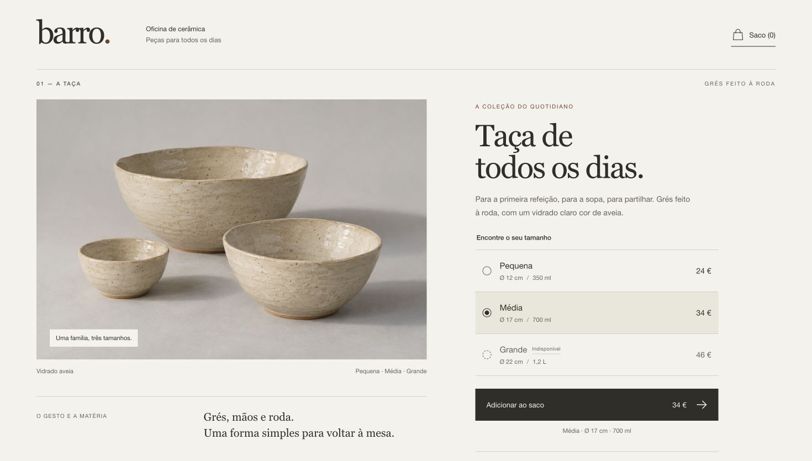
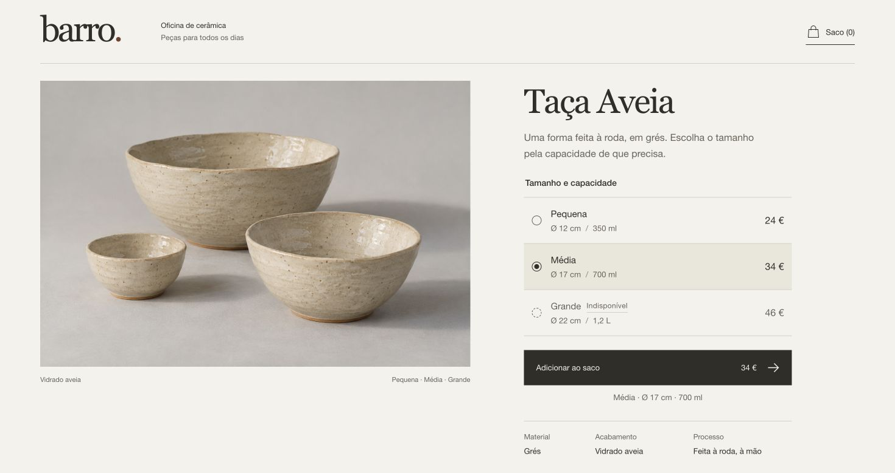
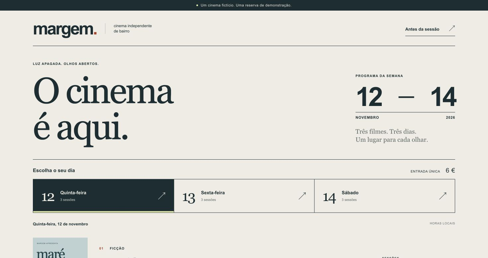
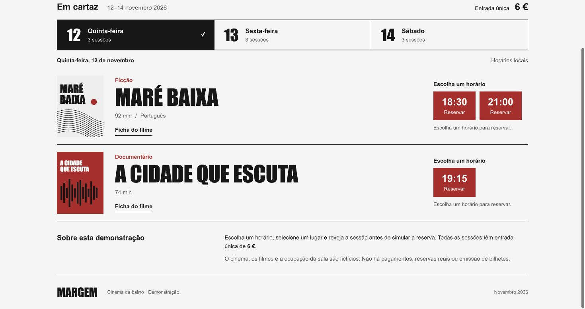
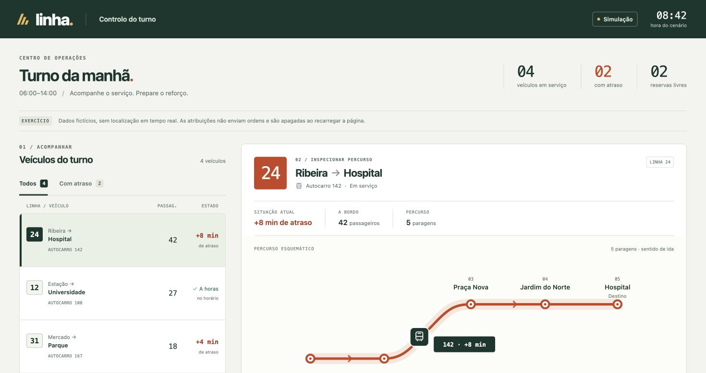
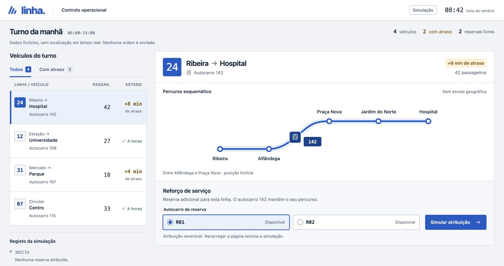

# Three rendered interface trials — 2026-11-12

Version 0.1.0 produced distinct task structures but still repeated visual habits. Browser review led to specific corrections and the instruction changes in v0.2.0. This report preserves that distinction: the final screenshots show **reviewer-directed revisions**, not an independent demonstration that v0.2.0 solves these problems on unseen briefs.

## Setup

Three independent delegated sessions each received one synthetic brief, the v0.1.0 skill and relevant references, and an isolated output directory. The other projects and evaluation conclusions were withheld. HTML/CSS/JavaScript, local SVG and a generated pottery image were available. No framework or external service was required. The parent evaluator ran the browser checks and directed revisions after comparing the outputs.

Host: Codex desktop on macOS, Chrome. Exact model build and sampling settings were not captured. Starting skill commit: `0b5b3b1ecc0f140e8e6dd0356328bcba2e3eca9a`; starting `SKILL.md` SHA-256: `48606f6baffa56ed34c4478db3e1607a2d24f3ae496acf55e91d6112a5175791`. There was one initial implementation per brief. This is an exploratory development round, not a controlled benchmark.

Sources and executable artifacts: [interface lab](../../examples/interface-lab/README.md). Initial attempts are in its `baseline/`; final implementations and gallery are in `dist/`. [QA record](../../examples/interface-lab/QA.md) lists observed interactions. [Asset provenance](../../examples/interface-lab/ASSETS.md) includes the generation prompt.

## Briefs and organizing decisions

| Project | Requirements supplied | Resulting structure |
| --- | --- | --- |
| Barro, small pottery workshop | Compare one oatmeal-glaze bowl family: small 12 cm / 350 ml / €24; medium 17 cm / 700 ml / €34; large 22 cm / 1.2 L / €46 unavailable. Select size, add to bag, edit quantity/remove. Portuguese, responsive, no checkout. | Large family photograph beside a capacity/size comparison; material identity, restrained serif heading, warm neutral surface, local bag. |
| Margem, neighborhood cinema | Three days, €6 admission. Thu 12 Nov 2026: Maré baixa (fiction, 92 min, Portuguese) 18:30/21:00; A cidade que escuta (documentary, 74 min) 19:15. Fri 13: Depois da chuva (animation, 68 min) 17:00/19:00; Maré baixa 20:00. Sat 14: Depois da chuva 16:00; A cidade que escuta 18:00; Maré baixa 21:00 sold out. Four rows × six seats, choose one, review and simulate reservation. | Compact date programme with film titles, posters and explicit session buttons; condensed billing typography and red masthead; seat map with session-specific state. |
| Linha, transit shift control | Line 24 Ribeira→Hospital, bus 142, +8 min, 42 passengers; line 12 Estação→Universidade, bus 108, on time, 27; line 31 Mercado→Parque, bus 167, +4 min, 18; line 07 Circular Centro, bus 115, on time, 33. Filter, inspect, assign exclusive spare R01/R02 to delayed lines, undo. Fictional schematic, no live dispatch. | Dense fleet list beside selected vehicle, route and response; cool neutral surface, blue identifiers/actions, tabular numbers and explicit delay state; vertical route on mobile. |

## Observed problems and revisions

| Observed in first output | Consequence | Revision |
| --- | --- | --- |
| Pottery and cinema shared a warm paper surface, serif-led hierarchy, quiet thin rules and muted accents despite different subject matter. | Task structures differed, but their combined visual grammar felt habitual. This is evaluator judgment, not a participant rating. | Retain material warmth for pottery; move cinema toward compact red/white/black programme typography, based on films and showtimes. No universal prohibition on serif or neutral colors. |
| Cinema opened with a large slogan before useful sessions. | Programme was displaced below the opening viewport. | Remove the hero and expose dates, price, films and session buttons immediately. |
| Transit repeated headings, numbering, summaries and vehicle metrics. | The response action fell below the first desktop screen. | Compress the shift header, combine selected-vehicle information, remove duplicate metrics and place reserve choices beside the action. Final action bottom measured at roughly 673 px in a 779 px viewport. |
| Decorative numbers, micro-labels and poetic pottery filler competed with decisions. | Added visual similarity and reduced emphasis on actual choice information. | Name the product, prioritize capacity/price/availability, remove unsupported labels and increase quantity controls to 44 px. Retain real line/seat identifiers and action sequence numbers. |

## Before and after

### Barro

Before:

After:

### Margem

Before:

After:

### Linha

Before:

After:

Earlier captures used the browser's then-current taller desktop viewport; final captures are 1470 × 779. Compare content ordering and composition, not a pixel-normalized vertical-space score.

## Verified behavior

The evaluator used normal browser controls to check size/price selection, quantity totals, removal, empty bag and persistence; all three cinema dates, sold-out/occupied states, single-seat choice, confirmation and isolation between sessions; and transit filtering, detail changes, exclusive reserve assignment, retained observed delay and undo. Escape/focus return and keyboard activation were exercised where relevant. Responsive inspection used measured 390 × 844 and 320 × 740 viewports; dialogs and actions were exercised at the narrow width. No horizontal document overflow was observed in those checks. No console errors or warnings were returned in the final prototype checks.

The gallery preview initially cropped screenshots because its HTML height attribute overrode the intended responsive ratio. That was corrected with automatic image height and re-inspected. This was a gallery implementation defect, not evidence about the independently generated prototypes.

Static checks covered JavaScript syntax, local asset references, SVG parsing, skill frontmatter and Markdown links. Contrast calculations in the design notes cover named color pairs only. These checks do not establish full WCAG conformance, screen-reader usability, production security or real-world conversion.

## Changes recorded in v0.2.0

- Compare the combined visual grammar of independent projects, in addition to information structure and silhouette.
- Inspect the actual first viewport; working tools should keep object, state and response together at their intended desktop size. Ordinary scrolling remains valid for browseable content.
- Give decision-critical data readable weight; remove unsupported slogans, repeated labels and decorative numbering, while preserving meaningful identifiers and sequences.
- Record real viewport dimensions and separate initial output from reviewer-directed correction.

Counterexamples matter: a branded second screen should stay consistent; a number identifying a bus or seat is useful; a serif pottery page is appropriate here; a landing page may need a deliberate introduction. These findings must not become one compulsory visual recipe.

## Remaining uncertainty

There was no no-skill control, blind rating, participant study, repeated sampling, native-app build or cross-browser/font-environment test. New independent v0.2 trials on held-out briefs are still needed to assess whether the new instructions generalize. The results support that these three revised prototypes work in the exercised scenarios; they do not prove universal distinctiveness, originality or superior UX.
